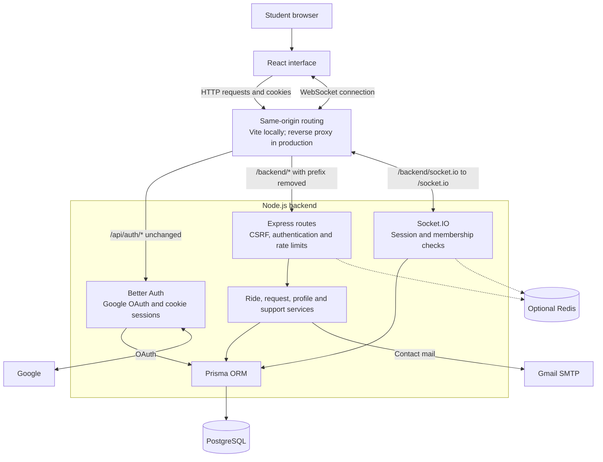
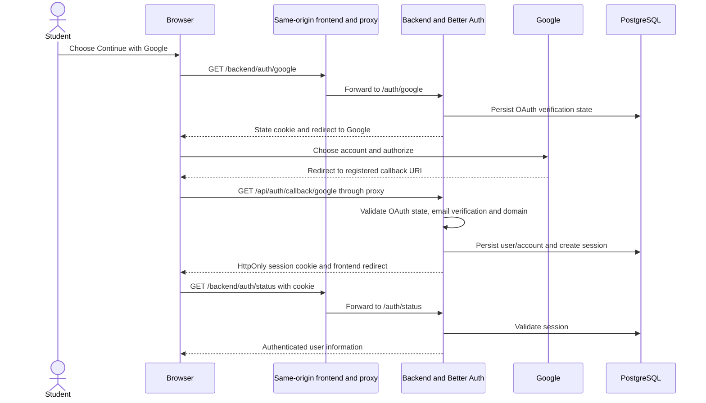
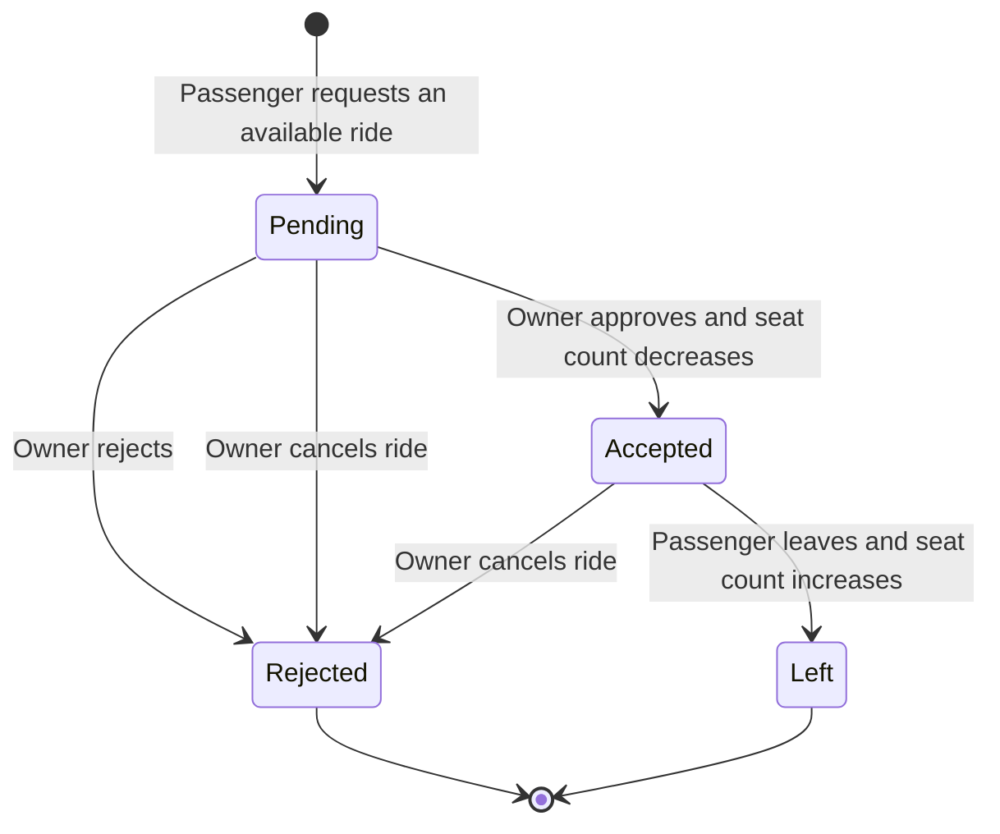
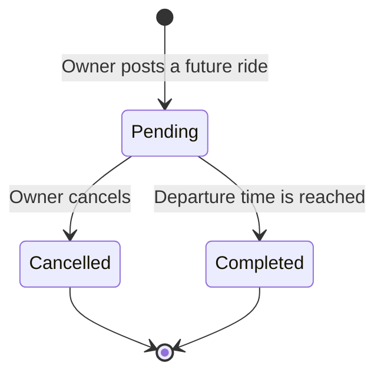
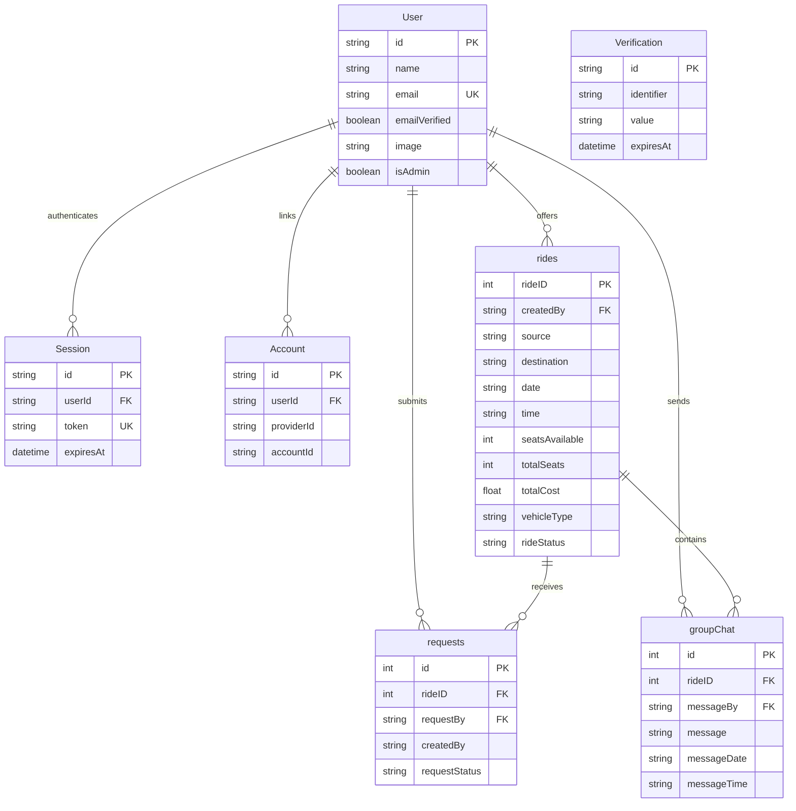
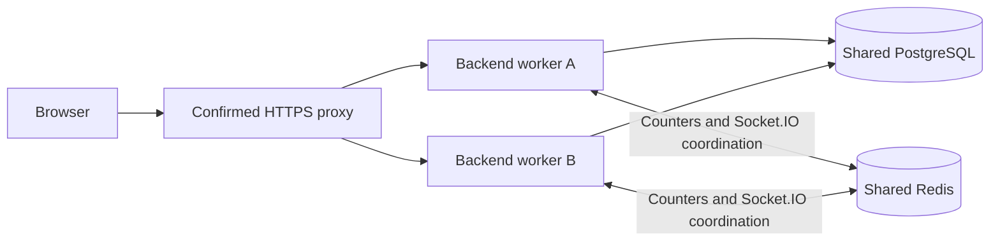

# Campus RideShare

**Find a ride. Share the journey. Coordinate with your campus community.**

Campus RideShare is a full-stack TypeScript application for campus carpooling.
Students can offer rides, search routes, request passenger seats, approve fellow
riders, and coordinate in private ride-group chats. The project is intended for
the IIT Indore community; permitted email domains are configurable.

[Features](#features) · [Architecture](#architecture) · [Authentication](#authentication-flow) · [Database](#database-model) · [Setup](#local-setup) · [API](#api-reference) · [Testing](#testing-and-verification) · [Deployment](#deployment-requirements)

> **Project status:** application code and local verification tools are available.
> College hosting, server specifications, a public domain, Redis availability,
> and capacity for 500 simultaneous students are **not confirmed**. The diagrams
> explain the implementation and optional deployment design, not an installed
> institute environment. Database reconciliation and an independent penetration
> test remain pending.

## Features

| Area | Implemented behavior |
| --- | --- |
| Sign-in | Google OAuth with verified-email and allowed-domain checks |
| Sessions | PostgreSQL-backed Better Auth sessions with HttpOnly cookies |
| Ride discovery | Server-side route/date/time search with pagination |
| Ride offers | Source, destination, departure, vehicle type, passenger seats and optional fare |
| Join requests | Owner approval/rejection; transactional request and seat updates |
| Ride management | Upcoming/history views, owner cancellation and passenger departure |
| Group chat | Membership-checked WebSocket rooms, recent history and reconnect handling |
| Profiles | Student identity, profile image, ride history and request management |
| Contact | Validated support form, support notification and acknowledgement email |
| Interface | Responsive layouts, custom date/time pickers and confirmation dialogs |
| Protection | Input validation, CSRF headers, origin checks, rate limits and security headers |

Redis-backed rate limits and Socket.IO coordination are implemented as an
**optional mode**. Their presence does not mean a Redis service is provisioned.

## Technology stack

| Layer | Technologies |
| --- | --- |
| Frontend | React 18, TypeScript, Vite, React Router, TailwindCSS |
| Interaction | Framer Motion, Lucide icons, nuqs, Axios |
| Backend | Node.js 24, Express 5, TypeScript |
| Authentication | Better Auth, Google OAuth, Prisma adapter |
| Data | PostgreSQL, Prisma ORM, PostgreSQL driver adapter |
| Real time | Socket.IO with WebSocket-only browser transport |
| Optional shared state | Redis, Socket.IO Redis adapter, Redis rate-limit stores |
| Support and logging | Nodemailer, Winston |
| Verification | Jest, Node test runner, signed-cookie HTTP/WebSocket simulations |

## Architecture

The frontend uses relative URLs. In development, Vite provides the proxy. A
production host must provide equivalent routing under one HTTPS origin.



### Request boundaries

- Browser API calls use `/backend`; the proxy removes that prefix before Express.
- Better Auth uses `/api/auth/*`, which the proxy forwards unchanged.
- Browser chat connections use `/backend/socket.io`, forwarded to `/socket.io`.
- State-changing application requests include `X-Requested-With: XMLHttpRequest`.
- User identity comes from the validated server session, not request-body IDs.
- Cookies are HttpOnly and SameSite=Lax; HTTPS deployments use Secure cookies.

## Authentication flow

Login starts through a top-level navigation. The backend forwards Better Auth's
OAuth state cookies before redirecting to Google. Successful callbacks set a
session cookie and return the browser to the frontend; session tokens are not
passed in the callback URL or stored in localStorage.



The production callback is `<public-origin>/api/auth/callback/google`. Local
setup retains the callback at `http://localhost:3000/api/auth/callback/google`;
localhost cookies are shared across ports. Callback state checks remain enabled.
Logout revokes the session, expires the cookie and disconnects that user's sockets.

## Ride and request lifecycle

A request does not reserve a seat until the owner accepts it. Acceptance checks
that the request is still pending, the ride is active and a seat remains; the
request and seat updates run in one transaction.



A unique `(rideID, requestBy)` constraint prevents duplicate request rows.
Previously rejected or departed passengers cannot re-request the same ride.

Ride status is separate from request status:



Departure validation and automatic completion use **Asia/Kolkata** time. Ride
expiry checks currently run during relevant service operations; the application
does not claim to have a separate background ride-expiry scheduler.

## Database model

The diagram uses Prisma model names. `User`, `Session`, `Account` and
`Verification` map to lowercase PostgreSQL table names. User IDs and their foreign
keys are **strings**; ride, request and chat-row IDs are integers.



`Verification` holds short-lived verification/OAuth state and has no declared
foreign-key relation to `User`. The diagram shows selected fields; the
[Prisma schema](ride_backend/prisma/schema.prisma) is the complete definition.

## Repository layout

```text
.
├── README.md
├── deploy/
│   └── nginx.example.conf          # Optional template; not an installed configuration
├── docs/
│   ├── DEPLOYMENT.md               # Proxy, environment and database instructions
│   ├── align-existing-database.sql # Unapplied reconciliation plan
│   ├── SECURITY_REVIEW_2026-10-27.md
│   └── load-test-results.json      # Historical local probe measurements
├── scripts/
│   └── load-test.mjs               # Bounded local, read-only HTTP probe
├── ride_backend/
│   ├── index.ts                   # Startup, sockets, cleanup and shutdown
│   ├── prisma/                    # Models and initial migration
│   ├── scripts/deploy-check.mjs    # Read-only configuration/model checks
│   ├── src/
│   │   ├── config/                # Environment, Prisma, Redis and sockets
│   │   ├── controllers/
│   │   ├── middleware/            # Session guard, CSRF, rate limits and errors
│   │   ├── routes/
│   │   ├── services/
│   │   ├── validation/
│   │   ├── app.ts
│   │   ├── chat.ts
│   │   └── lib/auth.ts
│   └── test/
└── ride_frontend/
    ├── src/
    │   ├── api/                   # Same-origin Axios client and API calls
    │   ├── components/
    │   ├── context/
    │   ├── hooks/
    │   ├── pages/
    │   ├── services/
    │   ├── types/
    │   └── App.tsx
    ├── test/deployment.test.mjs
    └── vite.config.ts             # Local proxy and build validation
```

## Local setup

### 1. Prerequisites

- Node.js **24.x** and npm.
- A PostgreSQL database you are authorized to use.
- Google OAuth web-client credentials and a registered local callback.
- Support-email credentials; outbound SMTP access is needed to test delivery.
- Redis only if intentionally enabling and testing shared-state mode.

### 2. Install and configure

From `ride_backend`, run `npm ci`. Do the same from `ride_frontend`.
Copy each directory's `.env.example` to `.env` and replace placeholder values.
Keep credentials out of Git.

Core backend settings for development:

```dotenv
NODE_ENV=development
SERVER_PORT=3000
FRONTEND_URL=http://localhost:5173
BETTER_AUTH_URL=http://localhost:3000
BETTER_AUTH_SECRET=<random-secret-at-least-32-characters>
COOKIE_SECURE=false
ALLOWED_DOMAINS=iiti.ac.in
DATABASE_URL=<PostgreSQL-runtime-connection-string>
DIRECT_URL=<PostgreSQL-direct-connection-string>
DATABASE_SSL=true
GOOGLE_CLIENT_ID=<Google-OAuth-client-ID>
GOOGLE_CLIENT_SECRET=<Google-OAuth-client-secret>
EMAIL_USER_SENDER=<support-sender-address>
EMAIL_APP_PASSWORD=<Gmail-app-password>
EMAIL_USER_RECEIVER=<support-recipient-address>
MULTI_INSTANCE=false
```

Set `DATABASE_SSL=false` only for a database that does not require TLS, such as a
local development instance. Migration tools use `DIRECT_URL`, falling back to
`DATABASE_URL`; a direct connection is recommended when runtime traffic is pooled.

The frontend's only API setting is optional:

```dotenv
VITE_BACKEND_URL=/backend
```

Omitting it has the same effect. Absolute backend URLs are rejected by the build.

Register this exact local Google redirect URI:

```text
http://localhost:3000/api/auth/callback/google
```

### 3. Initialize the database safely

For a **new, empty database**, from `ride_backend`:

```sh
npm run db:migrate:deploy
npm run prisma:generate
```

For an **existing database**, first follow the
[reconciliation and baseline procedure](docs/DEPLOYMENT.md#existing-database-reconciliation-is-pending).
A previous comparison found foreign-key/default drift. The reconciliation SQL
has **not been applied**, the data classification is unknown, and this README
update makes no database changes. Do not reset or recreate existing tables to
make setup succeed.

### 4. Start both applications

Backend terminal, working directory `ride_backend`:

```sh
npm run dev
```

Frontend terminal, working directory `ride_frontend`:

```sh
npm run dev
```

Open [localhost:5173](http://localhost:5173). The backend listens on port 3000
unless PORT or SERVER_PORT overrides it. Use `npm run build` followed by
`npm start` for the compiled backend. Vite's `npm run preview` serves the frontend
build for inspection; it does not install the production API/WebSocket proxy.

## API reference

The paths below are **backend paths**. Browser application requests prepend
`/backend` through the proxy, except Better Auth's `/api/auth/*` routes.
Mutating application requests require the CSRF header described above.

| Method | Backend path | Access / purpose |
| --- | --- | --- |
| GET | `/auth/google` | Public; begin Google login |
| GET | `/api/auth/callback/google` | Google callback handled by Better Auth |
| GET | `/auth/status` | Report current session status |
| POST | `/auth/logout` | Revoke session and expire cookie |
| GET | `/rides` | Signed in; paginated route/date/time search |
| POST | `/rides/addRide` | Signed in; create an offer |
| GET | `/rides/upcomingRides` | Signed in; own upcoming rides |
| GET | `/rides/completedRides` | Signed in; own completed rides |
| GET | `/rides/:rideID/group` | Ride owner or accepted passenger |
| POST | `/rides/:rideID/cancel` | Ride owner |
| POST | `/rides/:rideID/leave` | Accepted passenger |
| POST | `/request/sendRequest` | Signed in; request a seat |
| POST | `/request/handleRequest` | Owner accepts or rejects |
| GET | `/request/requestsSent` | Current user's pending requests |
| GET | `/request/requestsReceived` | Pending requests on current user's rides |
| GET | `/user/profile` | Current user's profile |
| POST | `/chat/rideMembers` | Ride members only |
| POST | `/contact` | Public, validated and rate-limited support form |
| GET | `/health` | Liveness |
| GET | `/ready` | Database connectivity and configured shared-state readiness |

Chat events include `joinRoom`, `getOlderMessages` and `chat message`. The backend
checks the session and ride membership; history is limited to the latest 200
messages, and message text is limited to 2,000 characters.

## Testing and verification

| Working directory | Command | Purpose |
| --- | --- | --- |
| `ride_backend` | `npm run build` | Generate Prisma client and compile TypeScript |
| `ride_backend` | `npm run typecheck` | Type-check without emitting output |
| `ride_backend` | `npm test` | Jest and Node auth/HTTP/WebSocket checks |
| `ride_backend` | `npm run deploy:check` | Read-only configuration and model-column checks; needs a build and database |
| `ride_frontend` | `npm run lint` | ESLint |
| `ride_frontend` | `npm run build` | TypeScript checks and production assets |
| `ride_frontend` | `npm run test:deployment` | Same-origin build-configuration checks |

The three-user simulation uses real signed-cookie validation and local HTTP/
WebSocket connections with in-memory sessions and mocked ride records. It covers
owner/member/outsider isolation, forged-cookie rejection, room revocation and
logout. It does not exercise live student records or production Google consent.

The cross-worker test is skipped unless `TEST_REDIS_URL` points to a disposable
test Redis service. To run it from `ride_backend` after configuring that variable:

```sh
node --import tsx --test test/redisIntegration.node.ts
```

### Local load probe

With the local backend running, start the frontend production preview on port
4173 from `ride_frontend`:

```sh
npm run build
npm run preview -- --port 4173
```

Then run the probe from the repository root:

```sh
node scripts/load-test.mjs
```

The probe targets local frontend HTML, `/health` and `/ready`, and saves
`docs/load-test-results.json`. It does not simulate authenticated bookings,
full browser rendering or chat workload. The recorded results are historical
local measurements, not an IIT server benchmark or proof of 500-user capacity.

## Deployment requirements

Production cookie sessions require the frontend and proxied backend on one
**HTTPS origin**. Set FRONTEND_URL and BETTER_AUTH_URL to that origin and
COOKIE_SECURE=true. Configure Google with the matching callback URL.

The [Nginx example](deploy/nginx.example.conf) is a template with placeholders;
it has not been installed on a college server. A split-host setup needs an
equivalent supported same-origin proxy first. The included SPA-only Vercel
configuration does not configure backend routing or a persistent chat proxy.

### Optional shared-state design

This diagram applies **only after** multiple workers and a shared Redis service
are confirmed and configured. Single-process local development needs no Redis.



Set `MULTI_INSTANCE=true` and `REDIS_URL` on every worker, using the same database,
origins and stable auth secret. Redis coordinates rate counters and socket-room
operations. When configured shared state is unavailable, affected requests are
rejected and local sockets disconnected. Cross-worker behavior still requires
testing against the actual chosen infrastructure.

Read the [deployment guide](docs/DEPLOYMENT.md) before selecting hosting or
applying database changes.

## Security and known limits

| Implemented protection | Boundary or remaining work |
| --- | --- |
| HttpOnly cookie sessions; no browser bearer-token storage | XSS can still perform actions through a compromised page |
| CSRF header and exact-origin checks | Production must preserve the intended proxy/origin configuration |
| Server-derived identity and ride membership checks | Real deployed multi-user workflows still need verification |
| Transactional request/seat updates | Sustained booking-concurrency tests remain outstanding |
| Optional shared rate limits and socket adapter | Redis provisioning and cross-worker verification are unconfirmed |
| Initial migration and reconciliation instructions | Existing database reconciliation/baseline has not been completed |
| Validated and escaped support input | Gmail SMTP needs valid credentials and permitted outbound ports |
| Automated tests and a local load probe | No independent penetration test or confirmed simultaneous-user limit |

The [historical security review](docs/SECURITY_REVIEW_2026-10-27.md) describes an
earlier revision. This README describes the current cookie-session implementation
and explicitly distinguishes prepared code from pending infrastructure.
